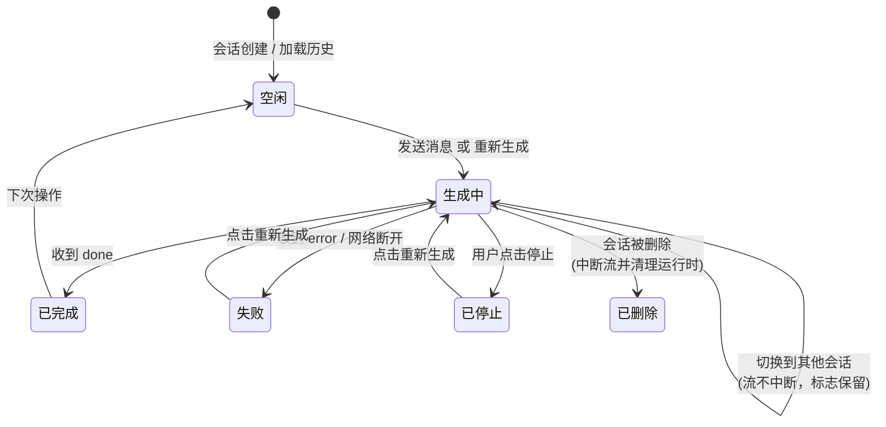

# 04 - 生成中新建与切换对话需求说明

> 智能客服系统 — 对话生成期间的会话切换能力变更
>
> 关联文档：`docs/prd/02_客服对话页.md`、`docs/dev_docs/02_客服对话页.md`

---

## 一、背景与现状

### 1.1 现状描述

当前客服对话页存在一条全局限制：**只要还有一个对话正在流式生成，用户就不能新建对话、不能切换对话**。

- 「新建对话」按钮被置灰，点击无响应；
- 点击侧边栏中的其他对话项，无任何反馈，停留在原对话；
- 只有等待生成结束、生成出错，或点击「停止」之后，上述操作才恢复可用。

### 1.2 现状实现根因

限制来自前端的一个**页面级全局布尔锁**，而非后端约束：

| 位置 | 现状实现 |
|------|---------|
| `frontend/src/views/ChatView.vue:97` | `const isStreaming = ref(false)` —— 全局唯一标志，不区分会话 |
| `frontend/src/views/ChatView.vue:98` | `let abortController: AbortController \| null = null` —— 全局唯一控制器，同一时刻只跟踪一个流 |
| `frontend/src/views/ChatView.vue:429` | `handleSelectSession()` 首行 `if (isStreaming.value) return`，切换被静默拦截 |
| `frontend/src/views/ChatView.vue:438` | `handleNewChat()` 首行 `if (isStreaming.value) return`，新建被静默拦截 |
| `frontend/src/views/ChatView.vue:453` | `sendMessage()` 同样以 `isStreaming.value` 为拦截条件 |
| `frontend/src/views/ChatView.vue:931` | 「新建对话」按钮 `:disabled="isStreaming"` |
| `frontend/src/views/ChatView.vue:1210` | `<ChatInput :streaming="isStreaming" ...>` —— 输入框/停止按钮跟随全局锁 |
| `frontend/src/api/chat.ts:171` | `streamChat()` 每次调用返回独立 `AbortController`，本身**支持多流并行** |

后端侧：

| 位置 | 结论 |
|------|------|
| `backend/routers/chat.py:54` | `POST /api/chat` 按请求携带的 `session_id` 生成，会话之间天然隔离 |
| `backend/services/agent_service.py:358` | `agent_loop_stream()` 为 async generator，每个请求独立一条 SSE 流 |
| `backend/services/session_service.py:5` | `threading.Lock` 仅保护内存临时会话字典，与"生成中"无关 |
| `backend/database.py:51` | `sessions.status` 表示会话状态（active），**不是生成状态** |

**结论**：后端不存在会话级生成锁，也不需要为本次变更新增生成状态字段。放开限制的核心是**前端把"全局单锁 + 单消息列表"改造成"按会话隔离的运行时状态"**。

### 1.3 本次变更要解决的问题

1. 生成中允许新建对话、允许切换到任意历史对话；
2. 切走之后原对话**继续在后台生成**，已产出内容不丢失；
3. 用户能明确看到哪些对话"正在生成"，且该标志在切走后依然可见；
4. 补齐由此派生出的缓存、草稿、停止、失败、删除、并发等逻辑闭环。

---

## 二、目标与非目标

### 2.1 目标

| 编号 | 目标 |
|------|------|
| G1 | 生成中可新建对话并立即进入新对话，原对话生成不中断 |
| G2 | 生成中可切换到任意其他对话，原对话生成不中断 |
| G3 | 切走再切回正在生成的对话，能看到**实时累积的完整内容**（思考过程 + 已输出的回复） |
| G4 | 会话列表、顶部标题区均有明确的「正在生成」标志，且不随视图切换而丢失 |
| G5 | 不同会话的流式生成互不干扰，可并行；同一会话仍禁止并发 |
| G6 | 停止、重新生成、删除、输入草稿等操作均按会话正确归属 |

### 2.2 非目标（本次不做）

| 编号 | 非目标 | 说明 |
|------|--------|------|
| N1 | 跨标签页 / 跨设备同步「正在生成」状态 | 沿用现有约定：不实时推送，重新打开页面时从数据库加载最终结果 |
| N2 | 会话列表中提供"一键停止"入口 | 用户需切回该会话后点击「停止」按钮；后续版本可评估 |
| N3 | 后端新增 `is_generating` 字段或生成任务队列 | 生成状态属于前端瞬时状态，不入库 |
| N4 | 后台生成完成后的弹窗 / 强提醒 | 仅更新列表摘要与标志，避免打扰当前阅读 |
| N5 | 页面刷新或关闭后继续生成 | 浏览器侧 `AbortController` 随页面卸载中断；后端可能已完成落库，刷新后按数据库结果展示 |

---

## 三、核心概念与状态模型

### 3.1 会话运行时（SessionRuntime）

新增一层**按会话 ID 索引的运行时状态**，取代当前的全局 `isStreaming` / `abortController` / 单 `messages` 引用。

| 字段 | 类型 | 说明 |
|------|------|------|
| `sessionId` | `string` | 会话 ID |
| `generating` | `boolean` | 该会话是否正在生成；为 `true` 时展示「正在生成」标志 |
| `controller` | `AbortController \| null` | 该会话当前流的控制器；`generating=false` 时应为 `null` |
| `messages` | `UIMessage[]` | 该会话的消息缓存，**包含在流的半成品消息**；切走切回以此为准 |
| `initialized` | `boolean` | 是否已从后端加载过历史消息；防止切回时用数据库内容覆盖半成品 |
| `draft` | `string` | 该会话独立的输入框草稿，切换会话时互不干扰 |
| `draftAttachments` | `PendingAttachment[]` | 该会话未发送的附件草稿（如需要） |
| `scrollTop` | `number` | 该会话消息区滚动位置（可选，建议保留以提升切回体验） |
| `error` | `string \| null` | 该会话最近一次生成错误，用于展示「重新生成」 |

### 3.2 派生状态（计算属性）

| 派生状态 | 计算方式 | 用途 |
|---------|---------|------|
| `currentRuntime` | `runtimes[currentSessionId]` | 当前所见会话的运行时 |
| `isCurrentStreaming` | `!!currentRuntime?.generating` | 传给 `<ChatInput :streaming>`，决定输入框置灰 / 停止按钮 |
| `generatingSessionIds` | `Object.keys(runtimes).filter(id => runtimes[id].generating)` | 会话列表「正在生成」标志的数据源 |
| `canNewChat` | 恒为 `true` | 新建对话不再受任何生成状态限制 |

### 3.3 状态流转



**关键约束**：`generating=true` 是**会话级**状态，不是页面级状态；它只在当前会话的 `done` / `error` / `stop` 事件发生时复位，任何其他会话的操作都不得改变它。

---

## 四、不同情况下的交互

### 4.1 场景总览

| 场景 | 用户操作 | 操作前状态 | 期望结果 |
|------|---------|-----------|---------|
| A | 生成中点击「新建对话」 | 会话 A 正在生成 | 新建会话 B 并进入；A 继续生成并显示标志 |
| B | 生成中点击其他历史对话 | 会话 A 正在生成 | 切换到会话 B；A 继续生成并显示标志 |
| C | 切走后切回原对话 | 会话 A 后台生成中 | 显示 A 的实时累积内容；输入框按 A 的生成状态置灰 |
| D | 在 B 中发送消息 | A 后台生成中，B 空闲 | B 开始独立生成；A、B 并行，互不影响 |
| E | 在当前会话点击「停止」 | 当前会话生成中 | 仅停止当前会话；其他会话生成不受影响 |
| F | 生成在后台结束 / 失败 | 用户正在看会话 B | 不自动跳转、不弹窗；A 的标志消失，列表摘要更新 |
| G | 同一会话再次发送 / 点重新生成 | 当前会话生成中 | 阻止并给出轻提示，避免同会话并发 |
| H | 删除正在生成的对话 | 该对话在后台生成中 | 中断该流、清理运行时；当前视图不受影响 |
| I | 多个会话同时生成 | A、B 均生成中 | 列表多项显示标志；各自独立停止 / 完成 |
| J | 刷新 / 关闭页面 | 有会话生成中 | 流被中断；重新进入按数据库结果展示 |
| K | 新建请求失败 / 慢网络 | A 正在生成 | A 的生成不受影响；给出创建失败提示 |
| L | 点击当前会话 / 搜索过滤 | 有会话生成中 | 无副作用，不改变任何生成状态 |

### 4.2 场景 A：生成中新建对话

1. 会话 A 正在流式生成，用户点击侧边栏「+ 新建对话」。
2. 系统**立即**调用 `createSession()` 创建会话 B（沿用现有流程：标题"新对话"去重、AI 问候语入库）。
3. 创建成功后：
   - 当前视图切换到会话 B，消息区展示 B 的问候语；
   - 会话 A 的 SSE 连接**保持不断开**，继续接收 token；
   - 会话 A 在对话列表中的条目显示「正在生成」标志。
4. 会话 B 的输入框立即可用（B 自身未生成）。
5. 若创建失败（网络错误 / 401），停留在会话 A，弹出轻提示"新建对话失败，请重试"，A 的生成不受影响。

### 4.3 场景 B：生成中切换到历史对话

1. 会话 A 正在流式生成，用户点击侧边栏中任意其他会话 B。
2. 系统切换 `currentSessionId` 到 B，并按现有流程加载 B 的历史消息（loading 态、分页、滚动到底部）。
3. 会话 A 的流**不调用 `abort()`**，其回调继续把内容追加到 `runtimes[A].messages` 中。
4. 会话 A 的列表项保持「正在生成」标志。
5. 点击的是当前会话 A 自身时视为空操作（不重复加载、不影响流）。

### 4.4 场景 C：切走后切回正在生成的对话

1. 用户在 A 生成期间切到 B，随后又切回 A。
2. 系统**优先使用 `runtimes[A].messages` 缓存**渲染，不重新执行 `loadMessages(A)` 覆盖（避免半成品内容被数据库内容冲掉）。
3. 用户看到：已确认落库的历史消息 + 思考过程 + 已流式输出的回复内容，且内容持续追加。
4. 顶部标题区显示 A 的名称及「正在生成」标志。
5. 输入框置灰，「停止」按钮可用（因为 A 正在生成）。
6. 滚动行为沿用现有规则：若用户在切回前处于底部则自动跟随；若用户向上翻阅，则保持阅读位置。

> **实现要点**：切回时判断 `runtimes[A].initialized && runtimes[A].generating`，为真则跳过历史加载；仅在 `initialized=false` 时从后端拉取。

### 4.5 场景 D：在其他对话发送消息（并行生成）

1. 会话 A 后台生成中，用户切到会话 B 并发送一条新消息。
2. 系统为 B 创建独立的 `AbortController` 和流式回调，写入 `runtimes[B]`；B 开始生成。
3. A、B 两条 SSE 流并行推进，各自的内容只写入各自的 `messages` 缓存。
4. 两个会话在列表中同时显示「正在生成」标志。
5. 任一会话结束只清理自己的 `generating` 状态和控制器，不得调用全局复位。

> 后端 `POST /api/chat` 已按 `session_id` 隔离，无需改动。

### 4.6 场景 E：停止生成

1. 「停止」按钮只与**当前所见会话**绑定：`streaming = isCurrentStreaming`。
2. 用户在当前会话点击「停止」：
   - 仅调用 `runtimes[currentSessionId].controller.abort()`；
   - 仅把当前会话的 `generating` 置为 `false`，清空其 `controller`；
   - 当前消息气泡 `isStreaming=false`，已输出内容保留；
   - 其他会话的流继续生成，标志不变。
3. 后台会话要停止，需先切回该会话再点击「停止」（本次不提供列表快捷停止入口，见 N2）。
4. 停止后的草稿保留策略沿用现有 PRD：输入框内容不清空，可继续编辑发送。

### 4.7 场景 F：生成在后台结束或失败

1. 会话 A 在后台生成，用户正在浏览 B。
2. A 收到 `done`：
   - `runtimes[A].generating = false`，`controller = null`；
   - A 的列表项标志消失，`last_message` 摘要更新为本次回复；
   - A 的半成品消息标记为已完成，补做最终 Markdown 渲染（含图片）。
3. A 收到 `error` 或 SSE 断连：
   - 同样清除标志；
   - A 的对话列表中该会话显示异常态标识（如"生成失败"文字或错误图标，与「正在生成」互斥）；
   - 用户切回 A 时，对应气泡下方显示「🔄 重新生成」按钮。
4. **不自动切换视图，不弹出模态框或 toast**，避免打断用户当前阅读。
5. 无论成功或失败，都调用 `loadSessions()` 刷新列表摘要；若列表发生重排序，标志必须跟随对应会话 ID 而非位置索引。

### 4.8 场景 G：同一会话的并发限制

1. 当前会话正在生成时：
   - 输入框置灰，发送按钮为「停止」，无法发送新消息；
   - 该会话内所有「重新生成」按钮隐藏或禁用。
2. 若因竞态（如双击）触发同会话第二次请求，前端必须再次校验 `runtimes[sid].generating` 并拦截，返回轻提示"当前对话正在生成中"。
3. 其他会话不受限制，可正常发送与重新生成。

### 4.9 场景 H：删除正在生成的对话

1. 用户删除会话 A（A 可能正在后台生成，且不是当前选中会话）。
2. 系统先调用 `runtimes[A].controller?.abort()` 中断其流。
3. 删除运行时缓存 `runtimes[A]`（含消息、草稿、控制器、错误态）。
4. 后端软删除会话及消息，前端列表移除该项。
5. 若删除的是当前会话，按现有规则切换到其他会话；若删到最后一条，自动新建对话。
6. A 的流回调在 abort 后可能仍产生一次 `error` 事件，回调中需判断运行时是否仍存在，存在才写状态，避免"给已删除会话写回内容"。

### 4.10 场景 I：多会话同时生成

1. 允许任意数量的不同会话同时处于生成中。
2. 会话列表中可同时出现多个「正在生成」标志。
3. 视图只渲染当前会话的消息，但后台会话的回调持续更新其缓存（仅内存操作，无 DOM 开销）。
4. 顶部标题区的标志只反映当前会话，不显示"共 N 个会话生成中"（避免信息过载）。

### 4.11 场景 J：刷新 / 关闭页面

1. 页面卸载时浏览器会中断所有 SSE 连接，前端运行时状态随之销毁。
2. 后端可能已经完成生成并落库 assistant 消息；再次进入页面时按数据库结果展示完整回复。
3. 若后端尚未落库，则该轮回复按现有"生成中断不持久化半成品"规则处理。

### 4.12 场景 K：新建失败与网络异常

1. `createSession()` 抛错时：不切换视图、不改动任何运行时状态，提示"新建对话失败，请重试"。
2. 401 响应沿用现有规则：清除 token 并跳转 `/login`（此时所有流随页面跳转自然终止）。
3. 生成中网络断开：按 4.7 的失败分支处理，仅影响出错的那个会话。

### 4.13 冲突与优先级规则汇总

| 冲突点 | 规则 |
|--------|------|
| 全局锁 vs 会话锁 | 取消全局锁；一切生成判断以 `runtimes[sid].generating` 为准 |
| 缓存 vs 数据库 | 已初始化且正在生成的会话，切回时**缓存优先**；已完成的会话可按需刷新 |
| 新消息 vs 生成中 | 同一会话禁止；不同会话允许 |
| 停止按钮作用范围 | 仅当前会话 |
| 标志归属 | 按 `session_id` 绑定，列表重排 / 搜索过滤不影响 |
| 删除 vs 生成中 | 删除优先：先 abort 再删除，回调需做存在性校验 |
| 切回滚动位置 | 沿用现有"用户在底部则跟随，向上翻阅则保持"规则 |

---

## 五、界面原型（ASCII）

> 下列原型基于 `docs/prd/02_客服对话页.md` 的 P3 客服对话页，仅标出本次变更相关元素。
> 图例：`◉ 正在生成` = 新增徽标；`▌` = 流式输出光标；`■ 停止` = 只作用于当前会话。

### 5.1 生成中切换到 / 新建其他对话（场景 A、B）

会话 A「退款咨询」仍在后台生成，用户已新建并进入会话 B「新对话」：

```
┌───────────────────────┬──────────────────────────────────────────────────────────────┐
│  [①] 侧边栏            │   [③] 新对话              标题右侧：无徽标      [④] 用户 · 退出 │
│                       ├──────────────────────────────────────────────────────────────┤
│ ┌───────────────────┐ │                                                              │
│ │ [①.1] + 新建对话   │ │  ← 生成中仍可点击（不再置灰）                                │
│ └───────────────────┘ │                                                              │
│ ┌───────────────────┐ │                                                              │
│ │ [①.2] 🔍 按名称搜索│ │                                                              │
│ └───────────────────┘ │              [⑤] 消息列表（当前：会话 B）                     │
│ ┌───────────────────┐ │                                                              │
│ │ [①.3] 对话列表     │ │   2025-06-02 14:32:10                                        │
│ │                   │ │   ┌──────────────────────────────────────┐                   │
│ │ ● 新对话       ◀当前│ │   │ 🤖 您好，我是智能客服小助手，有什么   │  ← B 的问候语       │
│ │   您好，我是智能... │ │   │    可以帮您？                        │                   │
│ │                   │ │   └──────────────────────────────────────┘                   │
│ │ ● 退款咨询  ◉正在生成│ │  ← A 后台生成，标志常驻                                      │
│ │   退款流程如下：1...│ │                                                              │
│ │                   │ │                                                              │
│ │ ✓ 订单查询        │ │                                                              │
│ │   已为您查询到...  │ │                                                              │
│ │ ... 加载更多 ▼     │ │                                                              │
│ └───────────────────┘ │                                                              │
├───────────────────────┼──────────────────────────────────────────────────────────────┤
│                       │  ┌─────────────────────────────────────────────────────────┐ │
│                       │  │ [⑦] 👎 不满意本次回答？                      (常显按钮)  │ │
│                       │  └─────────────────────────────────────────────────────────┘ │
│                       │  ┌────────────────────────────────────┐ ┌────────────────┐ │
│                       │  │ [⑥.1] 输入您的问题...               │ │ [⑥.2] 发送     │ │
│                       │  │  (B 未生成 → 输入框可用)             │ │                │ │
│                       │  └────────────────────────────────────┘ └────────────────┘ │
└───────────────────────┴──────────────────────────────────────────────────────────────┘
```

要点：
- 列表项不再有点击拦截，任意项可切换；
- A 的徽标与消息摘要随 SSE 更新，但右侧视图保持在 B；
- B 的输入框与发送按钮按 B 自身状态渲染（空闲 → 可发送）。

### 5.2 切回正在生成的对话（场景 C、E）

```
┌───────────────────────┬──────────────────────────────────────────────────────────────┐
│  [①] 侧边栏            │   [③] 退款咨询  ◉ 正在生成               [④] 用户 · 退出       │
│                       ├──────────────────────────────────────────────────────────────┤
│ │ + 新建对话           │                                                              │
│ │ 🔍 搜索...           │              [⑤] 消息列表（当前：会话 A，生成中）             │
│ ┌───────────────────┐ │                                                              │
│ │ ● 新对话          │ │   2025-06-02 14:31:02                                        │
│ │ ● 退款咨询 ◀当前   │ │        ┌──────────────────────────────┐                       │
│ │   ◉正在生成        │ │        │ 我想咨询退款流程 😊           │  ← 用户消息           │
│ │   退款流程如下：1...│ │        └──────────────────────────────┘                       │
│ │                   │ │                                                              │
│ │ ✓ 订单查询        │ │  2025-06-02 14:31:05                                          │
│ │                   │ │  ┌──────────────────────────────────────┐                     │
│ │                   │ │  │ 🤖 💭 思考中...                      │  ← 思考过程           │
│ │                   │ │  │ 正在检索退款政策...                  │                     │
│ │                   │ │  │ 已找到 3 条相关规则...               │                     │
│ │                   │ │  │ ──────────────────────────────────── │  ← 思考截止分隔线     │
│ │                   │ │  │ 退款流程如下：1. 进入订单中心...  ▌  │  ← 流式输出 + 光标    │
│ │                   │ │  └──────────────────────────────────────┘                     │
│ │                   │ │                                                              │
│ │ ... 加载更多 ▼     │ │  ↑ 切走期间产生的 token 全部保留，内容持续追加                 │
│ └───────────────────┘ │                                                              │
├───────────────────────┼──────────────────────────────────────────────────────────────┤
│                       │  ┌────────────────────────────────────┐ ┌────────────────┐ │
│                       │  │ [⑥.1] 输入您的问题...(置灰)        │ │ [⑥.2] ■ 停止   │ │
│                       │  │  (A 生成中 → 仅 A 被置灰)           │ │ 只停止 A       │ │
│                       │  └────────────────────────────────────┘ └────────────────┘ │
└───────────────────────┴──────────────────────────────────────────────────────────────┘
```

要点：
- 顶部标题区与列表项**同时**显示徽标，徽标按会话 ID 绑定；
- 气泡沿用现有「思考中 → 分隔线 → 流式回复」表现，切回时不重新加载历史、不丢失半成品；
- 「停止」按钮仅作用于当前会话 A，后台其他会话不受影响。

### 5.3 多会话并行生成与列表徽标细节（场景 D、F、I）

①.3 会话列表局部放大：

```
┌────────────────────────────────────┐
│ + 新建对话        （始终可点击）    │
├────────────────────────────────────┤
│ 🔍 按名称搜索...                   │
├────────────────────────────────────┤
│ ┌────────────────────────────────┐ │
│ │ ● 新对话-1        ◉ 正在生成    │ │ ← A：后台生成中
│ │   退款流程如下：1. 进入...      │ │   摘要实时更新（不自动跳转视图）
│ ├────────────────────────────────┤ │
│ │ ● 订单查询        ◉ 正在生成    │ │ ← B：与 A 并行生成，互不干扰
│ │   已为您查询到订单...           │ │
│ ├────────────────────────────────┤ │
│ │ ● 售后政策        ⚠ 生成失败    │ │ ← 与「正在生成」互斥；切回可见「重新生成」
│ │   当前网络似乎不太稳定...       │ │
│ ├────────────────────────────────┤ │
│ │ ● 物流查询                     │ │ ← 空闲：无徽标
│ │   您的包裹已发出...             │ │
│ └────────────────────────────────┘ │
└────────────────────────────────────┘
```

要点：
- 多项可同时显示 `◉ 正在生成`，每项独立对应一个 SSE 流与 `AbortController`；
- 后台会话完成时徽标消失、摘要更新为本次回复；失败时切换为 `⚠ 生成失败`，两者不共存；
- 列表重排或搜索过滤后，徽标仍跟随原会话 ID；
- 顶部标题区只显示**当前会话**的徽标，不显示"共 N 个会话生成中"。

---

## 六、「正在生成」标志规范

### 6.1 展示位置

| 位置 | 展示形式 | 出现条件 | 消失条件 |
|------|---------|---------|---------|
| ①.3 会话列表项 | 标题右侧追加小徽标：`● 正在生成`（圆点带呼吸动画），徽标不遮挡标题与摘要 | `runtimes[s.id].generating === true` | 该会话 `done` / `error` / `stop` / 被删除 |
| ③ 顶部对话名称区 | 标题右侧同样的徽标，尺寸略大 | `isCurrentStreaming === true` | 当前会话生成结束或切到非生成会话 |
| ⑤ 消息气泡 | 沿用现有思考动效与流式光标（`isStreaming` 在 `UIMessage` 上） | 该消息正在接收 token | `done` / `error` / `stop` |
| ⑥.2 发送/停止按钮 | 生成时显示「停止」 | `isCurrentStreaming === true` | 同上 |
| ⑥.1 输入框 | 生成时置灰，不可输入 | `isCurrentStreaming === true` | 同上 |

> 会话列表徽标是本次新增；其余位置沿用现有 UI，只是数据来源由全局锁改为会话级状态。

### 6.2 视觉要求

| 属性 | 取值 |
|------|------|
| 文案 | `正在生成`（后跟省略号动画亦可，如 `正在生成…`） |
| 圆点 | 主色小圆点，`opacity` 呼吸动画，周期约 1.2s |
| 字号 | 列表项内 11~12px，顶部标题区 12~13px |
| 颜色 | 使用现有主色 / 提示色，与「生成失败」错误色区分 |
| 布局 | 徽标置于标题右侧，采用 `flex-shrink: 0`；标题超长时省略号截断，**徽标不被挤掉** |
| 互斥 | 「正在生成」与「生成失败」不可同时出现 |
| 无障碍 | 徽标加 `title`/`aria-label="该对话正在生成中"` |

### 6.3 状态映射表

| 会话运行时状态 | 列表徽标 | 顶部徽标 | 输入框 | 按钮 |
|---------------|---------|---------|-------|------|
| 未初始化 / 空闲 | 无 | 无 | 可用 | 发送 |
| 生成中（当前会话） | 正在生成 | 正在生成 | 置灰 | 停止 |
| 生成中（后台会话） | 正在生成 | 无（顶部显示的是别的会话） | 按当前会话状态 | 按当前会话状态 |
| 已完成 | 无 | 无 | 可用 | 发送 |
| 生成失败 | 生成失败 | 无（切回后可见错误态） | 可用 | 发送 + 气泡「重新生成」 |
| 已停止 | 无 | 无 | 可用（保留草稿） | 发送 |

### 6.4 一致性说明

- 「正在生成」是**前端内存态**，只反映当前标签页内的生成活动；
- 多标签打开同一会话时，A 标签生成中，B 标签不会显示该标志（符合 N1）；
- 刷新页面后标志全部清空，按数据库实际结果展示。

---

## 七、相关逻辑补充

### 7.1 前端状态重构

| 改动 | 位置 | 说明 |
|------|------|------|
| 移除全局 `isStreaming` / `abortController` | `ChatView.vue:97-98` | 改为 `runtimes: Record<string, SessionRuntime>` |
| `handleSelectSession` 去掉全局拦截 | `ChatView.vue:428` | 删除 `if (isStreaming.value) return`；按 4.4 决定使用缓存还是加载历史 |
| `handleNewChat` 去掉全局拦截 | `ChatView.vue:437` | 删除 `if (isStreaming.value) return`；创建成功后初始化新运行时 |
| 按钮解绑全局锁 | `ChatView.vue:931` | 删除 `:disabled="isStreaming"`，新建对话始终可点 |
| `ChatInput` 绑定当前会话状态 | `ChatView.vue:1210` | `:streaming="isCurrentStreaming"` |
| `sendMessage` 按会话写入 | `ChatView.vue:452-545` | 校验 `runtimes[sid].generating`；回调写入 `runtimes[sid].messages`；结束时只复位该会话 |
| `stopStreaming` 按会话停止 | `ChatView.vue:551-561` | 参数化 `sid`；停止时不按 `messages.value` 末尾猜测目标消息，改用运行时中记录的流式消息引用 |
| `handleRegenerate` 按会话处理 | `ChatView.vue:563-622` | 校验该会话未生成；回调写入对应运行时 |
| `loadMessages` 与缓存协同 | `ChatView.vue` | 切回时缓存优先；完成会话可刷新；避免并发加载覆盖半成品 |
| 草稿隔离 | `ChatInput.vue` / `ChatView.vue` | 输入内容随会话切换保存 / 恢复，停止后保留 |

### 7.2 消息缓存与切换加载策略（关键）

```
切换会话 sid 时：
  rt = runtimes[sid]
  if (!rt.initialized):
      创建 rt，loadMessages(sid)，initialized = true
  else if (rt.generating):
      直接使用 rt.messages，跳过 loadMessages   // 防止覆盖流式半成品
  else:
      // 已完成会话：可直接用缓存；如需与数据库对齐，先确认无本地未落库内容
      使用 rt.messages（可选按需刷新）
  loadFeedbackStatus(sid)
  恢复 rt.draft 与 rt.scrollTop
```

**禁止**在流式回调中直接操作 `messages.value`（当前全局引用），必须写入 `runtimes[sid].messages`，否则会出现"A 生成的内容跑到 B 的消息列表里"。

### 7.3 滚动与渲染作用域

| 问题 | 处理 |
|------|------|
| `scheduleStreamScroll()` 会操作共享的 `messageArea` | 增加会话归属判断：只有产生该 token 的会话等于 `currentSessionId` 时才滚动，避免后台流把当前视图滚到底部 |
| `_thinkingContentEl` 缓存指向旧 DOM | 切换会话时重置缓存；或通过会话 ID 校验缓存元素是否属于当前消息区 |
| `_renderTimers`（WeakMap，按 msg 建键） | 现状已按消息对象隔离，可保留 |
| `_streamingRender` 全局标志 | 仅在 `syncDerived` 同步执行期间置位，可保留；需确认多会话并发时不会交叉（单线程同步调用，安全） |
| 后台会话的最终 Markdown 渲染 | `done` 时仍执行 `scheduleRender`，但因 `_streamingRender=false`，图片正常只请求一次 |

### 7.4 会话列表更新

- 流开始时：立刻在列表项渲染「正在生成」标志（无需请求后端）。
- 流结束时：调用 `loadSessions()` 更新 `last_message` 摘要与 `updated_at`；列表若重排，按 `session.id` 匹配徽标。
- 列表分页加载更多时：新增项若正在生成，同样按 ID 查运行时并渲染徽标。
- 搜索过滤：过滤只影响展示，不影响任何生成状态。

### 7.5 后端与数据模型

| 项目 | 结论 |
|------|------|
| `POST /api/chat` | 无需改动，已按 `session_id` 隔离；不同会话可并行 SSE |
| SSE 事件结构 | 无需改动，继续发送 `content` / `reasoning` / `task` / `error` / `done` / `warning` |
| 数据库 `sessions` 表 | 不新增 `is_generating` 字段；生成态不入库 |
| `messages` 表 | 无需改动；`done` 时落 assistant 消息，中止 / 失败不落半成品（沿用现有规则） |
| 会话级并发 | 后端仍不限制；由前端保证同一会话不并发（见 4.8） |
| 附件存储 | 沿用 `data/uploads/sessions/{sid}/messages/{mid}/`，按会话隔离，无需改动 |

### 7.6 异常与兜底

| 异常 | 处理 |
|------|------|
| 回调到达时运行时已被删除 | 直接 return，不写状态、不渲染 |
| 同一会话收到重复的 `done` / `error` | 幂等处理：先检查 `generating`，已为 false 则忽略 |
| `abort()` 后仍收到缓存 token | 在回调入口检查 `controller.signal.aborted`，为真则丢弃 |
| 会话 ID 为空时发送消息 | 沿用现有逻辑：先自动新建对话再发送 |
| 大量会话同时生成 | 运行时仅保存在内存，随会话删除清理；后台会话不做 DOM 渲染，开销可控 |
| 401 过期 | 清除 token 跳转登录，运行时随页面销毁 |

---

## 八、涉及文件清单

| 文件 | 改动类型 | 说明 |
|------|---------|------|
| `frontend/src/views/ChatView.vue` | 主要改动 | 运行时状态模型、所有生成/切换/新建/停止/删除逻辑、列表徽标模板与样式 |
| `frontend/src/api/chat.ts` | 轻微改动（可选） | `streamChat` 已支持多实例；如需统一回调签名或增加 `onAbort` 可在此调整 |
| `frontend/src/components/ChatInput.vue` | 轻微改动 | 确认 `streaming` prop 语义改为"当前会话是否生成中"；草稿由父组件按会话管理 |
| `docs/prd/02_客服对话页.md` | 文档修订 | 更新 3.1 / 3.3 / 3.5 / 3.7 / 七 / 十 中相关描述（见第八节） |
| `docs/dev_docs/02_客服对话页.md` | 文档修订 | 更新状态管理与流程伪代码说明 |
| 后端代码 | 无需改动 | 已满足会话隔离要求 |

---

## 九、对现有 PRD 的修订点

| 章节 | 原描述 | 修订为 |
|------|--------|--------|
| 区域说明 ⑥.1 | "AI 生成期间输入框不可输入（置灰）" | "**当前会话**生成期间，该会话输入框不可输入；切换到其他会话后按该会话状态决定" |
| 3.1 新对话 | 未提及生成中新建 | "生成中也可新建；新对话创建后立即进入，原对话继续生成并显示「正在生成」" |
| 3.3 发送消息 第 6 条 | "AI 回复期间不支持发送新消息" | "同一对话回复期间不支持发送新消息；**其他对话可正常发送，支持并行生成**" |
| 3.5 停止生成 | 未明确作用范围 | "停止按钮只作用于当前会话，不影响其他正在生成的对话" |
| 3.7 切换对话 | 未提及生成中切换 | "生成中可切换；原对话继续生成，列表保留「正在生成」标志；切回时展示实时累积内容" |
| 七、加载状态规范 | 未定义生成标志 | 增加「正在生成」徽标规范（见本文第五、六节） |
| 十、技术备注 | "AI 生成期间输入框置灰…不支持连续发消息" | 改为"按会话维度的生成状态，支持跨会话并行生成" |

---

## 十、验收标准

| 编号 | 验收项 | 通过标准 |
|------|--------|---------|
| AC1 | 生成中新建 | A 生成中点击新建成功进入 B；A 的流未中断，内容持续追加；A 列表项显示「正在生成」 |
| AC2 | 生成中切换 | A 生成中切到 B，A 未中断；切回 A 能看到切走期间产生的全部内容 |
| AC3 | 标志正确 | 列表徽标与顶部徽标按会话 ID 显示；done / error / stop / delete 后正确消失；列表重排后不串位 |
| AC4 | 并行生成 | A、B 同时生成，内容各自写入正确会话；完成一个不影响另一个 |
| AC5 | 停止作用域 | 在当前会话点停止，只停当前会话；后台会话继续生成 |
| AC6 | 失败处理 | 后台会话失败后标志消失、摘要更新；切回可见「重新生成」按钮 |
| AC7 | 同会话防并发 | 生成中无法在当前会话再次发送或重新生成；双击不产生第二条流 |
| AC8 | 删除处理 | 删除后台生成中的会话后，流被中断、运行时清理、无异常报错 |
| AC9 | 草稿隔离 | A 输入一半切到 B，B 的输入框为空；切回 A 草稿仍在 |
| AC10 | 滚动行为 | 后台流不会滚动当前会话；切回 A 时遵循"底部跟随 / 顶部保持"规则 |
| AC11 | 回归 | 现有的停止、重新生成、SSE 断连、分页、搜索、删除、401 跳转均保持原有行为 |
