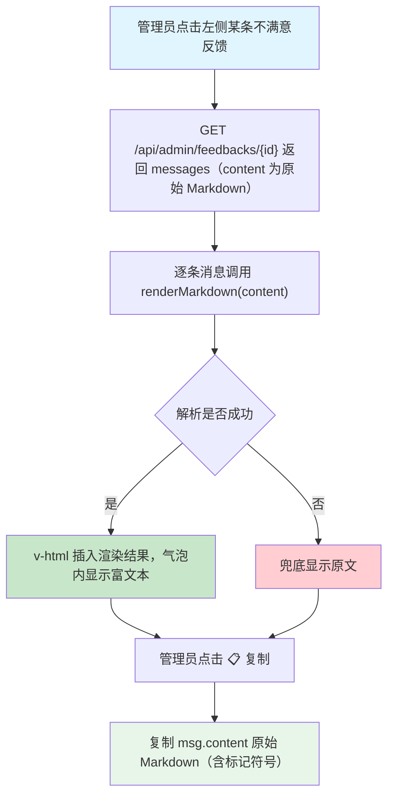

# 08 - 不满意回答对话预览 Markdown 渲染需求说明

> 智能客服系统 — 为管理端「不满意回答」页的对话内容预览区域补齐 Markdown 渲染能力，使管理员看到的回复与用户端一致
>
> 关联文档：`docs/prd/03_管理员后台页.md` §六、`docs/prd/02_客服对话页.md`
>
> 分工：本文只定义用户可感知的需求、交互规则与验收标准；本次为纯前端改动，文件级改动清单见第七章「涉及模块与技术备注」，配套开发文档后续补齐

---

## 一、背景与现状

### 1.1 现状描述

| 位置 | 现状 |
|------|------|
| `frontend/src/views/admin/FeedbackTab.vue:305` | 对话详情区每条消息以 `{{ msg.content }}` 纯文本插值展示，Vue 自动 HTML 转义，`#`、`**`、列表、代码块等 Markdown 标记按字面显示 |
| `frontend/src/components/messageUtils.ts:32` | 已提供 `renderMarkdown()`：`marked` 解析，`breaks: true`、`gfm: true`，自定义 renderer 处理 `../assets/` 图片路径，解析异常时兜底返回原文 |
| `frontend/src/components/AgentChatMessages.vue:96` | 用户端客服对话页消息气泡通过 `v-html="msg._renderedHtml ?? msg.content"` 渲染 Markdown |
| `frontend/src/components/MaintenanceChatDialog.vue:93` | 后台维护助手对话直接 `v-html="renderMarkdown(msg.content)"` |
| `frontend/src/views/admin/AgentConfigTab.vue:135` | 后台 `.md` 文件预览已具备完整的 `.markdown-body` 排版样式（`h1~h3`、`p`、`code`、`pre`、`ul/ol`、`blockquote`、`a`、`table`，当前为 `scoped`） |
| `backend/routers/feedback.py:136` | 详情接口从 `messages` 表原样读出 `content`，返回**原始 Markdown 文本**（仅标准 JSON 字符串转义），未做 HTML 转义或 Markdown→HTML 转换 |

**问题**：同一份 AI 回复，在用户客服对话页呈现为排版后的富文本（标题、加粗、列表、代码块、表格、图片），在「不满意回答」预览区却是一堆 Markdown 原文符号。管理员核对答复质量、定位格式问题时需要"脑内翻译"，降低处理效率，也容易误判为"用户端显示异常"。

### 1.2 根因与可用能力

| 分类 | 说明 |
|------|------|
| 根因 | 「不满意回答」页是后建的后台页面，消息气泡直接使用 Mustache 插值，未接入项目已有的 Markdown 渲染链路 |
| 可用能力 1 | `renderMarkdown()` 已封装 `marked` 配置与图片路径改写，用户端与维护助手均已在用，行为可直接对齐 |
| 可用能力 2 | `AgentConfigTab.vue` 的 `.markdown-body` 样式可作为预览区排版基础，无需从零设计 |
| 本次要解决的问题 | 在不改后端、不改数据结构、不改变复制行为的前提下，让预览区展示与用户端一致的渲染结果 |

---

## 二、目标与非目标

### 2.1 目标

| 编号 | 目标 |
|------|------|
| G1 | 对话详情区中用户与 AI 消息的 `content` 均按 Markdown 渲染展示，而非显示原始标记符号 |
| G2 | 渲染效果与用户端客服对话页一致（同一套 `renderMarkdown()` 配置与图片路径规则） |
| G3 | 每条消息旁的复制按钮仍复制**原始 Markdown 文本**，渲染不改变剪贴板内容 |
| G4 | 本次变更为纯前端展示层改造，不改动后端接口、数据库与消息存储内容 |

### 2.2 非目标（本次不做）

| 编号 | 非目标 | 原因 |
|------|--------|------|
| N1 | 引入 HTML 净化（如 DOMPurify） | 与现有三处 `v-html` 实现保持一致，避免单页行为分叉；统一治理列入后续评估项 |
| N2 | 渲染 `reasoning_content`、`steps`、附件 | 详情接口未返回这些字段，预览区现状也不展示，不在本次范围 |
| N3 | 将改写输入区（Q / A 文本框）改为 Markdown 编辑/预览 | 输入框是纯文本 `textarea`，且提交后按原文写入 FAQ，改动会影响知识库内容 |
| N4 | 流式/打字机渲染 | 后台预览是静态快照，无流式数据来源 |
| N5 | 修改左侧列表摘要、筛选、改写提交与向量化流程 | 与本次渲染需求无关，须保证回归无退化 |
| N6 | 新增前端依赖 | `marked` 已在依赖清单中，直接复用即可 |

---

## 三、核心规则

### 3.1 渲染范围

| 对象 | 是否渲染 | 说明 |
|------|---------|------|
| 对话详情区每条消息的 `content`（含 `role = 'user'` 与 AI） | 是 | 用户消息也可能含 Markdown（如粘贴的格式化问题），统一渲染保持一致性 |
| 对话详情区复制按钮 | 否 | 继续复制 `msg.content` 原文，含 `#`、`**`、换行等标记 |
| 左侧对话列表的标题摘要 | 否 | 列表只显示摘要文本，不做 HTML 注入 |
| 改写输入区 Q / A 文本框 | 否 | 保持纯文本编辑 |

### 3.2 渲染规则

| 编号 | 规则 |
|------|------|
| R1 | 统一调用 `frontend/src/components/messageUtils.ts` 的 `renderMarkdown(content)`，不在本页重复实现解析逻辑或修改 `marked` 全局配置 |
| R2 | 沿用现有配置：`breaks: true`（单换行渲染为 `<br>`）、`gfm: true`（表格、删除线、任务列表等 GFM 语法）、自定义图片 renderer |
| R3 | 图片路径以 `../assets/` 开头的，继续按现有规则改写为 `/assets/` 后加载 |
| R4 | `content` 为空或空白时，渲染结果为空字符串，气泡正常占位、不报错 |
| R5 | 解析异常时由 `renderMarkdown()` 兜底返回原文，页面不出现空白或报错 |
| R6 | 渲染只作用于展示层，`msg.content` 的值不变；复制、后续改写流程读取的仍是原始文本 |
| R7 | Markdown 排版样式限定在对话详情区的消息气泡内生效，避免污染后台其他区域 |

---

## 四、功能需求与界面原型

在现有「不满意回答」页 ⑦.2 对话详情区内，仅替换消息内容的呈现方式，区域布局、头像、时间戳、复制按钮位置均不变。

```text
【改造前】                              【改造后】
┌─ 对话详情 ──────────────────┐        ┌─ 对话详情 ──────────────────┐
│ 👤 用户:                    │        │ 👤 用户:                    │
│ 我想咨询退款流程             │        │ 我想咨询退款流程             │
│                             │        │                             │
│ 🤖 AI:                      │        │ 🤖 AI:                      │
│ ## 退款流程   📋             │        │ 退款流程                    │ (大标题)
│ **步骤 1**: 提交申请\n      │        │ 步骤 1: 提交申请             (加粗)
│ - 订单中心\n- 填写原因\n     │        │ • 订单中心  • 填写原因       (列表)
│ ```javascript\ncode\n```    │        │ ┌─────────────────────────┐ │ (代码块)
│                             │        │ │ code                    │ │
│                             │        │ └─────────────────────────┘ │
│                             │        │                          📋 │
└─────────────────────────────┘        └─────────────────────────────┘
        原始标记按字面显示                    渲染为排版后的富文本
                                            复制按钮内容不变（仍是原文）
```

| 编号 | 交互点 | 说明 |
|------|--------|------|
| ① | 消息内容气泡 | 由纯文本插值改为 Markdown 渲染后的 HTML；用户消息与 AI 消息规则一致 |
| ② | 📋 复制按钮 | 位置、显隐时机、点击行为均不变，复制内容仍为原始 Markdown |

---

## 五、交互流程



**场景 A — 查看反馈详情**：管理员选中一条反馈 → 详情加载完成 → 消息内容按 Markdown 渲染，排版与用户端对话页一致。
**场景 B — 复制原文**：管理员点击任意消息旁的复制按钮 → 剪贴板得到接口返回的原始 `content`，不受渲染影响，可直接粘贴到改写输入区。
**场景 C — 切换反馈 / 重新加载**：消息列表替换后重新渲染，不残留上一条对话的内容或样式。
**场景 D — 纯文本内容**：消息不含 Markdown 语法 → 渲染后视觉与改造前一致，无额外空行或样式变化。

---

## 六、异常处理矩阵

| 场景 | 前端表现 | 后端处理 |
|------|---------|---------|
| `content` 为空或空白 | 气泡显示为空，无报错 | 无（原样返回空字符串） |
| `content` 含 `../assets/` 图片 | 由 renderer 改写为 `/assets/` 后加载，行为与用户端一致 | 无 |
| 图片地址失效 | 展示浏览器默认破图行为，不额外拦截（与用户端一致） | 无 |
| `content` 含原始 HTML 标签 | 由 `marked` 按 GFM 规则处理，与用户端相同；不做额外净化 | 无 |
| `content` 含数学公式（`$...$`） | 不引入 KaTeX，按普通文本/Markdown 规则处理 | 无 |
| `renderMarkdown()` 解析抛错 | 由工具函数兜底显示原文，页面不崩溃 | 无 |
| 详情接口请求失败 | 沿用现有 loading / 错误表现，无新增行为 | 沿用现有错误处理 |

---

## 七、涉及模块与技术备注

### 7.1 改动清单

| 模块 | 文件 | 改动概要 |
|------|------|---------|
| 前端 | `frontend/src/views/admin/FeedbackTab.vue` | 引入 `renderMarkdown()`；消息气泡由 `{{ msg.content }}` 改为 `v-html` 渲染；补充 `.markdown-body` 作用域样式；复制逻辑保持不变 |
| 前端（复用，原则上不改） | `frontend/src/components/messageUtils.ts` | 直接复用 `renderMarkdown()`，不调整 `marked` 全局配置 |
| 前端（样式来源） | `frontend/src/views/admin/AgentConfigTab.vue` | 参考其 `.markdown-body` 样式；若提取为共享样式，须保证该文件现有预览不受影响 |

### 7.2 明确无需改动

| 模块 | 说明 |
|------|------|
| 后端 | `backend/routers/feedback.py`、消息存储逻辑均不改动，接口仍返回原始 Markdown |
| 数据库 | 表结构、已存消息内容不改动 |
| API 封装 / 路由 | `frontend/src/api/admin.ts`、路由配置不改动 |
| 依赖清单 | 不新增依赖 |

### 7.3 技术备注

| 项目 | 说明 |
|------|------|
| 渲染函数 | `renderMarkdown(text)`，来自 `frontend/src/components/messageUtils.ts` |
| 渲染时机 | 详情数据到达、消息列表替换时逐条渲染；无流式场景，无需节流 |
| 样式作用域 | Markdown 排版样式仅在对话详情区消息气泡内生效，避免影响列表、改写区与后台其他 Tab |
| 安全约束 | 与其他已有 `v-html` 位置行为一致，不做额外净化；统一净化方案列入后续评估 |

---

## 八、对现有 PRD 的修订点

| 章节 | 原描述 | 修订为 |
|------|--------|--------|
| `docs/prd/03_管理员后台页.md` §六 6.1 ⑦.2 | 「完整消息记录……内容气泡……复制按钮」 | 补充：消息内容按 Markdown 渲染展示，展示效果与用户端一致；复制按钮仍复制原始 Markdown 文本 |
| `docs/prd/03_管理员后台页.md` §六 6.6 | 「点击可将该条消息内容复制到剪贴板」 | 明确：复制的是含 Markdown 标记的原始文本，不受预览区渲染影响 |

---

## 九、验收标准

| 编号 | 验收项 | 通过标准 |
|------|--------|---------|
| AC1 | 富文本渲染 | 打开含 `# 标题`、`**加粗**`、`- 列表`、```代码块```、`\|表格\|`、图片链接的 AI 回复，预览区显示对应排版而非原始标记符号 |
| AC2 | 全角色覆盖 | 用户消息与 AI 消息中的 Markdown 均被渲染，规则一致 |
| AC3 | 复制原文 | 点击任意消息的复制按钮，剪贴板内容与接口返回的 `content` 完全一致（含 `#`、`**`、换行），可原样粘贴到改写输入区 |
| AC4 | 换行与 GFM | 单换行渲染为换行、GFM 表格正常成表，与用户端对话页表现一致 |
| AC5 | 图片路径 | `../assets/` 开头的图片在预览区正常加载，路径与用户端一致 |
| AC6 | 切换与重载 | 依次切换多条反馈详情，渲染结果正确且无上一条对话内容残留 |
| AC7 | 异常兜底 | 空内容、纯文本、解析异常内容均不导致页面空白、报错或控制台异常 |
| AC8 | 回归项 | 筛选、日期分组展开/收起、拖拽分隔条、改写 Q&A 增删、完成处理与 FAQ 写入流程均不受影响 |
| AC9 | 输入区不变 | 改写输入区 Q / A 仍为纯文本编辑，不出现渲染后的 HTML |

---

## 十、后续可评估项

| 项目 | 说明 |
|------|------|
| 统一 HTML 净化 | 为项目内全部 `v-html` 位置（客服对话、维护助手、配置预览、本预览区）统一引入净化方案，降低不可信内容风险 |
| 样式与渲染链路收敛 | 将 `.markdown-body` 从 `AgentConfigTab.vue` 提取为全局/共享样式，消除多组件重复，并在本次验证无回归后再推进 |
| 图片交互对齐 | 用户端已有图片点击放大，评估后台预览区是否需要同等能力 |
| 长内容与表格适配 | 评估超长代码块、宽表格在小尺寸面板下的横向滚动表现 |
| 数学公式支持 | 如后续 FAQ 中出现 `$...$` 公式需求，再评估引入 KaTeX |
